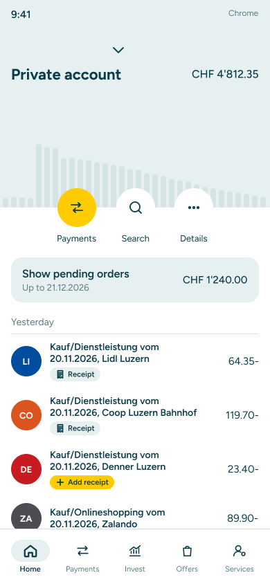

# Psst — the AI assistant inside your bank

**Ask about your money in your own words, in your own language. It stays between you and your bank.**

**Live demo:** <https://callmesusan.vercel.app> · **Pitch deck:** [docs/Pitch.pdf](docs/Pitch.pdf) ·
**Design:** [Figma Design-Project](https://www.figma.com/design/oOu7PPG4eIaWZPFVOELCCI/Design-Project?node-id=0-1)

Built by team **Call me Susan** at the Powercoders x Tech & Beyond hackathon
[“AI for Access”](https://hackathon.powercoders.org/en/) (Bern, 20–21 November 2026) for the
challenge **Beyond the List** by PostFinance AG.

<p align="center">
  
</p>

<!-- Demo video / GIF: add the link after code freeze. -->

## The problem

Bank apps show lists. People want answers.

- **Numbers, not answers.** A donut chart shows that money went out — not why, and not what to change.
- **Bank language.** “Kauf/Dienstleistung vom 20.11.2026, Supermarkt…” — German only, and no receipt.
- **AI, but not with my bank data.** People ask AI about everything, yet nobody gives an outside
  chatbot access to their accounts.

**Who it is for:** individuals who find bank apps hard to read — newcomers, older users and anyone
facing a language barrier. No finance knowledge needed.

## What Psst does

Psst lives inside the PostFinance app, where people already look — no new app.

| Feature | What you get |
| --- | --- |
| **Receipt for every purchase** | Each card payment shows what you actually bought, item by item, with a category (dairy, coffee, chocolate, alcohol…). Receipts come from the store app or from a photo. A Psst insight compares the month's item spending with a usual month. |
| **Scan a paper receipt** | The yellow Scan button reads a receipt photo, and Psst finds the matching bank payment by amount, date and store. |
| **Ask Psst (chat)** | “Am I spending too much on chocolate?” — plain-language answers with your real numbers, grounded only in your data. Suggested questions as chips. |
| **Voice input** | Tap the mic and ask instead of typing. |
| **Analytics + Ask Psst** | Yearly income and expenses by month, with Ask Psst right next to the chart. |
| **Any language** | English, German, Ukrainian, Russian and Arabic (right-to-left). |

**Trust by design:** Psst is read-only — it can look at your money but never pay, transfer or sign.
Every suggested action waits for your confirmation. Ask “What can you see?” and Psst lists exactly
the data it uses. The demo uses only the organisers' sample data, no real customer data.

## How AI is used

AI does the work where rules alone fall short; totals are calculated by code, and the AI explains them.

| Task | How |
| --- | --- |
| Read receipt photos | A vision model turns the photo into structured receipt JSON (items, prices, VAT, categories) |
| Answer money questions | An LLM answers over the user's spending data, in the user's language, with the numbers it used |
| Voice to text | A speech model transcribes the chat mic recording |

All models run through [OpenRouter](https://openrouter.ai); the model per task is set in `.env`
([docs/stack.md → AI models](docs/stack.md#ai-models)).

## Architecture

```text
React mobile web app (apps/web)
        │  /api/...
        ▼
FastAPI — Psst API (services/api)
  accounts · transactions + receipts · spending summaries
  receipt scan + matching · voice to text · chat
        │                         │
        ▼                         ▼
Sample data (JSON)        OpenRouter (vision, speech, chat models)
services/api/app/data
```

One Vercel project serves both: the frontend as static files and FastAPI as a serverless function
([docs/deploy.md](docs/deploy.md)). Every PR gets a preview URL; `main` goes to production.

| Part | Tech |
| --- | --- |
| Frontend | Vite, React, TypeScript, Tailwind v4, shadcn/ui, React Router, i18next, Vitest |
| Backend | Python 3.12, FastAPI, uv, pytest, ruff |
| AI | OpenRouter via the `openai` SDK |
| Deploy | Vercel (CI: GitHub Actions) |

## Quick start

Requirements: Python 3.12 with [uv](https://docs.astral.sh/uv/), Node.js LTS.

```bash
git clone https://github.com/Itin-dev/callmesusan.git && cd callmesusan
bash scripts/bootstrap.sh     # once: git hooks, pre-commit, shellcheck
cp .env.example .env          # add your OPENROUTER_API_KEY

make api   # terminal 1 → http://localhost:8000 (API docs at /docs)
make web   # terminal 2 → http://localhost:5173
```

The screens work without a key; the chat, receipt scan and voice input need `OPENROUTER_API_KEY`.
Run all checks with `bash scripts/validate.sh`.

## Team Call me Susan

| Name | Role |
| --- | --- |
| Yurii Masalitin | Dev + DevOps |
| Liubov Kulyk | UI/UX designer |
| Yury Georgievsky | Developer |
| Denis Plishko | Product owner |

## How we built it

We worked with Claude Code as an AI pair programmer, Figma for design, and GitHub issues plus a
project board for every ticket (decisions, tickets and ideas were dictated straight into issues).
Every change went through a small pull request with the same checks locally and in CI.

- Contributing and branch workflow: [CONTRIBUTING.md](CONTRIBUTING.md)
- All docs: [docs/INDEX.md](docs/INDEX.md) — product scope in [docs/mvp.md](docs/mvp.md) and
  [docs/features.md](docs/features.md)
- Agent setup: [CLAUDE.md](CLAUDE.md), [docs/agent-os.md](docs/agent-os.md)

## License

MIT — see [LICENSE](LICENSE).
